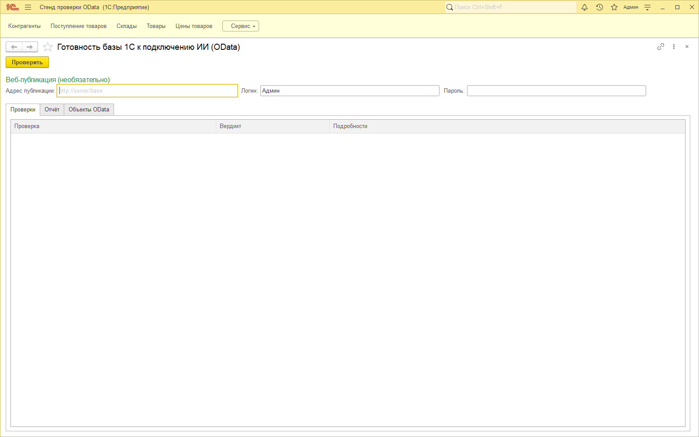
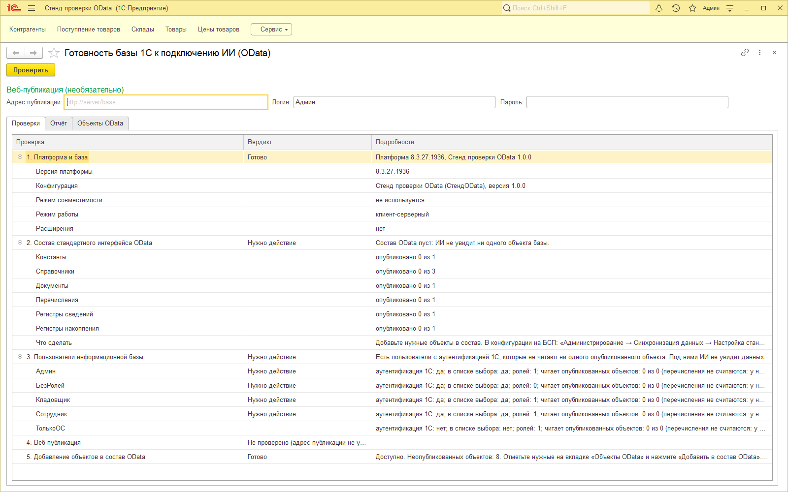
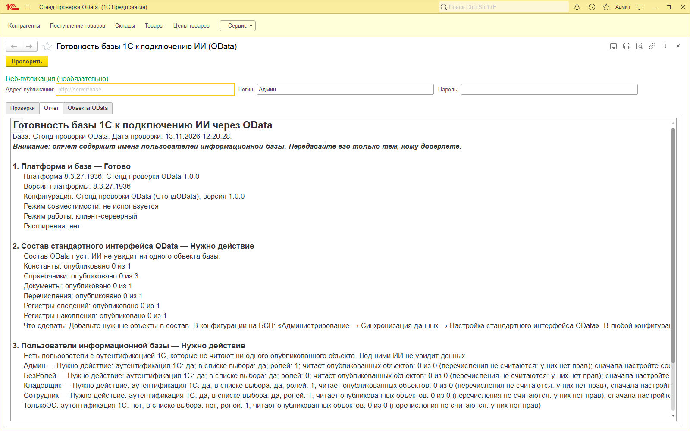
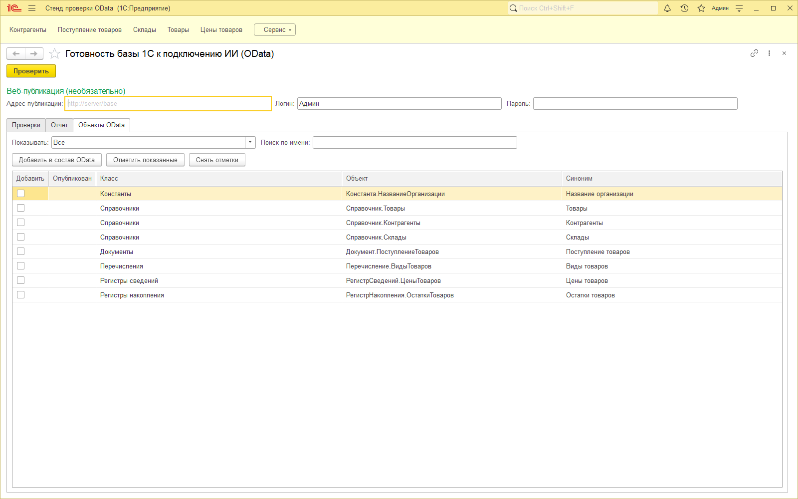

# Готовность базы 1С к подключению ИИ (OData)

Публикация на Инфостарте: https://infostart.ru/1c/tools/2843017/

Бесплатная внешняя обработка с открытым кодом. Она проверяет, готова ли база 1С к тому, чтобы ИИ-ассистент читал её через стандартный интерфейс OData под правами конкретного сотрудника.

Каждая проверка даёт один из вердиктов: «Готово», «Нужно действие» или «Не проверено» с причиной. К вердикту «Нужно действие» приложено, что сделать.

## Что проверяет

1. **Платформа и база.** Версия платформы; имя, синоним и версия конфигурации; режим совместимости; файловый или клиент-серверный режим; расширения с версиями.
2. **Состав стандартного интерфейса OData.** Сколько объектов опубликовано по классам. На вкладке «Объекты OData» список опубликованных и неопубликованных объектов с отбором. Пустой состав даёт «Нужно действие».
3. **Пользователи информационной базы.** По каждому пользователю:
   - есть ли аутентификация 1С, нужная для входа по OData с логином и паролем;
   - показывается ли он в списке выбора;
   - сколько у него ролей;
   - сколько опубликованных объектов он может читать.

   Пользователь с аутентификацией 1С, который не читает ни одного опубликованного объекта, получает «Нужно действие».
4. **Веб-публикация, по желанию.** Укажите адрес публикации (например, `http://server/base`), логин и пароль. Обработка запрашивает `{адрес}/odata/standard.odata/$metadata` и показывает код ответа и число наборов (EntitySet). Для ответов 401 и 404, отказа соединения и ответа HTML вместо XML выводится понятное сообщение.
5. **Добавление в состав OData.** Отметьте объекты на вкладке «Объекты OData» и нажмите «Добавить в состав OData». Обработка покажет список и попросит подтверждения. Объекты она только добавляет и никогда не убирает. После записи проверки повторяются.

Отчёт на вкладке «Отчёт» можно сохранить или скопировать и отправить специалисту. В отчёте есть имена пользователей ИБ, об этом предупреждает его шапка.

## Скриншоты

## Чего не делает

- Не меняет данные, конфигурацию и расширения. Единственное исключение — кнопка «Добавить в состав OData», и только после подтверждения.
- Ничего не отправляет наружу, кроме запроса из п. 4 по адресу, который вы ввели. Телеметрии нет.
- Не читает пароли и их хеши. Пароль из п. 4 живёт только в форме: он не сохраняется в настройках и не попадает в отчёт и журнал регистрации.
- Не читает бизнес-данные: только метаданные, пользователей и права.
- Не зависит от БСП: проверена на конфигурации без неё.

## Требования

- Платформа 8.3.27 или новее (проверено на 8.3.27.1936). На более ранних версиях не проверялась.
- Открывает обработку пользователь с правом открытия внешних обработок. Для проверок 2, 3 и 5 нужны административные права. Без них эти проверки покажут «Не проверено», а не ошибку.
- Для списка расширений нужно право «Администрирование расширений конфигурации».
- Тонкий клиент и веб-клиент.

## Исходники

Готовый файл: `ГотовностьБазыКПодключениюИИ.epf` в корне репозитория (собран из `src/` на платформе 8.3.27).

Каталог `src/` — XML-выгрузка Конфигуратора. Чтобы собрать `.epf`: «Конфигуратор → Файл → Открыть» корневой `ГотовностьБазыКПодключениюИИ.xml` из `src/`, затем «Файл → Сохранить как». Или из командной строки: `1cv8 DESIGNER ... /LoadExternalDataProcessorOrReportFromFiles src\ГотовностьБазыКПодключениюИИ.xml ГотовностьБазыКПодключениюИИ.epf`.

Лицензия MIT, см. `LICENSE`. Автор: Nulio.

Подключить ИИ к базе под правами сотрудника: [nulio.ru](https://nulio.ru/specialistam/?utm_source=github&utm_medium=readme&utm_campaign=odata_check).
